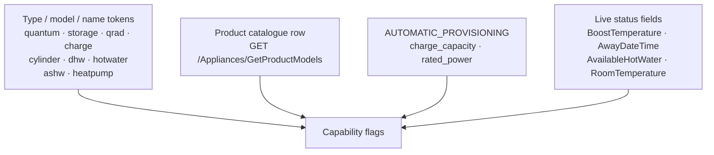

# Appliance support

This page says plainly what is **verified** against real hardware, what is **inferred** from
reading the official app, and what is **untested**. The underlying library does the same in
its [decompiled API reference](https://github.com/KRoperUK/dimplex-controller-py/blob/main/docs/decompiled-api-reference.md),
and it matters here for the same reason: an untested feature that looks supported wastes
somebody's evening.

The integration is developed against the hardware its authors and reporters own. Nobody has
access to the full Dimplex range.

## By family

| Family                                        | Status                                  | Notes                                                                                                                                  |
| --------------------------------------------- | --------------------------------------- | -------------------------------------------------------------------------------------------------------------------------------------- |
| Panel heaters, PLX, other simple room heaters | **Verified**{ .status-verified }        | Exercised routinely. Climate, presets, setpoint writes and modes all confirmed.                                                        |
| QRAD                                          | **Verified**{ .status-verified }        | As above, plus energy telemetry.                                                                                                       |
| Quantum storage heaters                       | **Partly verified**{ .status-inferred } | Modes and energy confirmed. Setpoint and timer writes are **rejected on some units** — see below.                                      |
| Hot water cylinders                           | **Partly verified**{ .status-inferred } | Status, holiday mode and the schedule (read) verified on an ASHW cylinder. Temperature, boost and hygiene writes untested — see below. |
| Air-source heat pump cylinders (ASHW)         | **Partly verified**{ .status-inferred } | Verified on an EDL200UK-630RF: handled as a hot water cylinder, with the heat-pump endpoints.                                          |
| Hygiene / anti-legionella cycles              | **Untested**{ .status-untested }        | The recurrence is read (a sensor) but never written.                                                                                   |

If you own something in the untested rows and are willing to try it,
[say so on an issue](https://github.com/KRoperUK/dimplex-controller-hass/issues) — a
[diagnostics download](../help/diagnostics.md) alone is genuinely useful.

## Quantum and other storage heaters

Charge-based heaters store heat overnight at the cheap rate and release it during the day.
Two consequences that repeatedly confuse people:

**A target does nothing until there is stored charge.** Set 22 °C at midday on a heater that
has exhausted its charge and nothing observable happens — not because the write failed, but
because there is no heat to release. Two of the tests in
[#163](https://github.com/kroperuk/dimplex-controller-hass/issues/163) came back inconclusive
for exactly this reason.

**Some units reject remote writes.** `SetApplianceSetpointTemperature` and `SetTimerMode` can
come back **HTTP 403**. The integration handles this:

- Setpoint writes fall back to the older schedule-rewrite path, so you keep the capability.
- If that is refused too, you get a readable error naming the appliance rather than a generic
  "unknown error" — this was
  [#149](https://github.com/kroperuk/dimplex-controller-hass/issues/149).

When comparing behaviour, compare against the **official app at the same moment**, not
against what a panel heater would do.

## Hot water cylinders

Verified on an air-source heat pump cylinder (`ASHW Cylinder`, model `EDL200UK-630RF`) by
comparing the cloud's replies with the official app at the same moment:

| What                  | Cloud                                                                    | App                           |
| --------------------- | ------------------------------------------------------------------------ | ----------------------------- |
| Hot water available   | `AvailableHotWater` = 336                                                | "336 L Hot water" — litres    |
| Target                | `ActiveSetPointTemperature` = 45                                         | 45°                           |
| Mode                  | `ApplianceModes` = 8192 (`Normal`), no `TimerMode` bit                   | "Timer"                       |
| Holiday               | `Holiday` bit (8) plus `HolidayNumOfDays`                                | "Holiday"                     |
| Green energy, heating | `IsGreenEnergyActive`, `HeatingUp`                                       | "Green energy mode is active" |
| Hygiene recurrence    | `HygieneFrequency` = 7                                                   | "7 days"                      |
| Tank size             | `Capacity` = 200                                                         | —                             |
| Error / warning       | `ErrorCode` / `WarningCode` = **integer** `0` (room heaters send `null`) | —                             |

What the integration does with a cylinder:

- **No thermostat.** A cylinder reports its water target in `ActiveSetPointTemperature`, which
  library releases up to 0.13.1 read as room climate — the cylinder got a climate entity with a
  7-30 °C range its 45 °C target could not fit, plus room temperature, open window, EcoStart and
  setback entities. Room-heater features are now stripped from a hot water appliance unless it
  also reports a room temperature.
- A **Water heater** entity (read-only): the app's mode and the target temperature.
- Sensors for hot water available (L), tank capacity, mode, hygiene recurrence and holiday
  days; binary sensors for heating, green energy and holiday. See [Entities](entities.md#water-heater).
- **Holiday** — a switch and a **Holiday ends** date and time. `SetApplianceModeHeatPumpHwc`
  with `Holiday` engages it (status 8192 → 8200, heating stops) and clears it again. The
  cylinder counts holidays in whole days, so the integration also clears Holiday itself at the
  chosen time; the rounded-up day count is still sent so the cylinder comes off holiday on its
  own if Home Assistant is down.
- **Schedule, read only.** Heat-pump cylinders keep it behind
  `ApiGetTimerModeDetailsForHeatPumpHwcAppliance` (one `{DayOfWeek, StartTime, Mode}` per
  period, no `TimerMode`). `UpdateHeatPumpHwcSchedulePeriods` answered **HTTP 403** to every
  request shape tried, so the schedule cannot be edited from Home Assistant.
- The two actions, [`dimplex.set_hot_water_temperature`](actions.md#dimplexset_hot_water_temperature)
  and [`dimplex.set_hot_water_hygiene`](actions.md#dimplexset_hot_water_hygiene), are
  unchanged and **still untested** on hardware.

Not yet known: what the schedule's `Mode` values mean (a live cylinder only ever showed `2`),
whether `StartTime` counts minutes after midnight, and how the app computes the fill
percentage it shows next to the target.

## How capabilities are decided

The matrix resolves the flags from four sources, in increasing specificity:

The catalogue is fetched once per account and matched to each appliance on its model, then its
type. It carries the `AUTOMATIC_PROVISIONING` metadata — and it is the only place `storage`,
`energy_meter`, `hot_water` and `heat_pump` come from, which is why the integration calls it
rather than guessing from the appliance's own name. An account whose catalogue cannot be read
falls back to the type tokens and is retried on the next poll.

- `charge_capacity > 0`, or a storage-ish token → **storage**
- `rated_power > 0`, or a storage-ish token → **energy meter**
- a cylinder token, or `AvailableHotWater` present → **hot water**, and `climate: false`
  unless a room temperature also appears
- an `ashw` / heat-pump token → **heat pump** (and hot water)

Control flags — boost, away, advance, open window, EcoStart, frost, timer, setpoint writes —
**default to enabled**. That is deliberate: the cloud exposes these generically, and guessing
"unsupported" would lock people out of endpoints that work. The cost is that an unsupported
call fails at the cloud rather than being hidden, which is why control errors are surfaced
with a readable message.

Your appliance's resolved flags are in a
[diagnostics download](../help/diagnostics.md) under `capabilities`.

## Confirmed but deliberately not exposed

| Endpoint                                                      | Why not                                                                                          |
| ------------------------------------------------------------- | ------------------------------------------------------------------------------------------------ |
| `ECO` mode (bit 64)                                           | Behaviour on real hardware unknown. See [modes](../use/modes.md#the-eco-preset-is-not-eco-mode). |
| `HOLIDAY`, `MANUAL`, `HYGIENE`, `STANDBY` and other mode bits | Read into diagnostics, never written.                                                            |

`SetSetbackTemperature` used to be on this list. It is now written by the
[setback target](entities.md#numbers) number entity, gated on the capability matrix's
`setback_write` — treated as **inferred** from the app until someone confirms it against a real
appliance.

Schedule writes are exposed as two actions rather than a full editor —
[copy a schedule](actions.md#dimplexcopy_schedule) and
[edit one period](actions.md#dimplexset_period_setpoint). Creating, deleting or reordering
periods still needs the official app.

## Temperature ranges

Only two are confirmed:

| Mode                                    | Range      | Status                                                                |
| --------------------------------------- | ---------- | --------------------------------------------------------------------- |
| Away                                    | 7–18 °C    | **Verified**{ .status-verified } — live, and matches the app's picker |
| Frost protection                        | fixed 7 °C | **Verified**{ .status-verified }                                      |
| Normal setpoint, boost, advance, manual | 7–30 °C    | **Inferred**{ .status-inferred } from the app                         |

Away turning out to be an exception means the 7–30 figures should not be fully trusted.
[dimplex-controller-py#98](https://github.com/KRoperUK/dimplex-controller-py/issues/98) tracks
re-reading each mode's range.

## Next

- [Modes & presets](../use/modes.md) — what each mode does
- [Diagnostics](../help/diagnostics.md) — see your own appliance's resolved capabilities
- [Troubleshooting](../help/troubleshooting.md)
